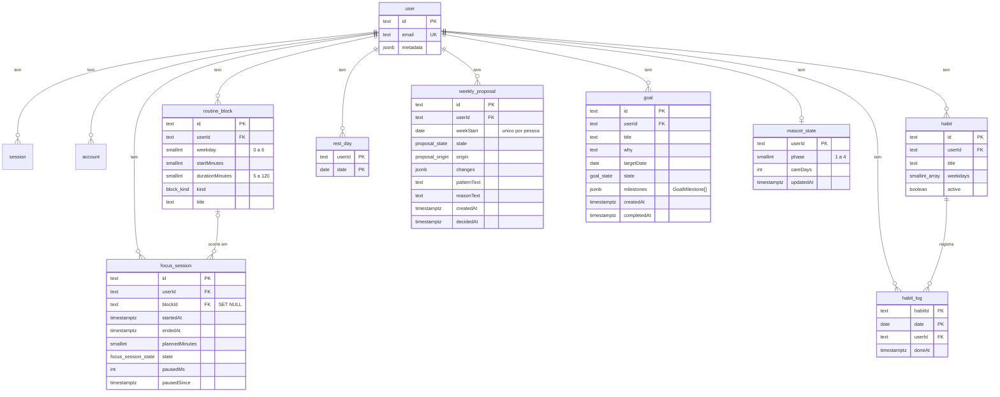

# Banco de dados

PostgreSQL com Prisma 7, no pacote `packages/db` (`@pulo/db`). Todos os dados do domínio ficam no servidor,
sempre por pessoa logada. O modo demo continua local e não passa por aqui.

## Tabelas



`session`, `account` e `verification` são do Better Auth (nomes e colunas mantidos). Toda tabela do domínio tem
`userId` com `onDelete: Cascade`: apagar a conta apaga tudo da pessoa ("Apagar todos os meus dados").

Regras que o banco garante (migração `restricoes`, em SQL):

- no máximo UMA `focus_session` com `state = 'em_andamento'` por pessoa (índice único parcial);
- `em_andamento` se, e somente se, `endedAt` é nulo;
- fase do sapo de 1 a 4, dia da semana de 0 a 6, duração do bloco de 5 a 120;
- um `habit_log` por hábito e dia, um `rest_day` por dia, uma `weekly_proposal` por semana, um `mascot_state` por pessoa;
- `habit_log` só aponta para hábito da mesma pessoa (chave composta `habitId, userId`).
- `goal` concluída se, e somente se, tem `completedAt`; `milestones` é sempre um array JSON (migração `metas`).
  O limite de metas ativas (`GOALS.maxActive`) é da API, numa transação serializável.

Convenções de tipo: `DateKey` do domínio ('AAAA-MM-DD', o dia lógico) é `date`; instantes (ms) são `timestamptz`;
os enums do Prisma têm os mesmos valores das uniões de `packages/core/domain/types.ts`.
Os ids das tabelas do domínio têm `@@unique([id, userId])` para dar upsert seguro por dono:
`where: { id_userId: { id, userId } }`.

## Rodar

Na raiz do repositório, com `.env` copiado de `.env.example`:

```sh
npm run db:up        # Docker Compose (PostgreSQL 17); sem Docker, use: npm run db:embedded
npm run db:deploy    # aplica as migrações
npm run db:seed      # dados sintéticos, só em banco local
npm run db:studio    # Prisma Studio
npm run db:generate  # regenera o cliente (roda sozinho no npm install e nas tarefas do Turborepo)
```

Para Supabase ou Hyperdrive, veja o README, seção "Banco de dados".

## Criar uma migração

1. Edite `packages/db/prisma/schema.prisma`.
2. `npm run db:migrate` (pede o nome; cria `packages/db/prisma/migrations/<data>_<nome>/migration.sql` e aplica no banco local).
3. Revise o SQL. Coisas que o Prisma não expressa (CHECK, índice parcial) vão em SQL à mão, numa migração própria:
   `npm run db:migrate -- --create-only --name minha_regra`, edite o arquivo e rode de novo para aplicar.
4. Rode os testes (`npx turbo run test --filter=@pulo/db`): eles aplicam todas as migrações num Postgres limpo.
5. Nunca edite uma migração que já foi para a `main`: crie outra.

Em produção, o CI roda `prisma migrate deploy` com o secret `DATABASE_URL` antes de subir o Worker.

## Como usar no código

```ts
import { createDb, habitMapper } from '@pulo/db';

const db = createDb(env.DATABASE_URL);               // UM por requisição, nunca compartilhado
const rows = await db.habit.findMany({ where: { userId } });
const habits = rows.map(habitMapper.toDomain);       // entidades do @pulo/core
await db.habit.upsert({
  where: { id_userId: { id: habit.id, userId } },
  create: habitMapper.fromDomain(userId, habit),
  update: { title: habit.title },
});
ctx.waitUntil(db.$disconnect());                     // depois de responder
```

No Worker, `src/worker.ts` já faz isso e entrega o `db` para `createApp`.
Cada entidade tem `toDomain(row)` e `fromDomain(userId, entidade)`; valores fora do domínio lançam `RangeError`
e o Json `changes` das propostas é validado por zod. Sem `any` e sem `as`.

## Regras contra N+1

1. `select` explícito: peça só as colunas que a rota usa.
2. Relações vêm em UMA query: o `relationJoins` está ligado e `join` é o padrão. Escreva
   `relationLoadStrategy: 'join'` mesmo assim, para ficar claro e para não depender do padrão.
3. Nenhuma query dentro de `for`, `map` ou `forEach`. Precisa de vários registros? Um `findMany` com `where: { id: { in } }`,
   ou `createMany`, `updateMany` e `groupBy` para somar no banco.
4. Intervalo de datas é uma query só, com `where: { userId, date: { gte, lte } }`; os índices `(userId, date)` já existem.
5. Várias leituras independentes na mesma rota: `Promise.all` com poucas queries fixas, ou `db.$transaction([...])`.
6. Toda rota nova de dados ganha um teste com `countQueries` fixando o número de queries (não cresce com a quantidade de dados).

## Contar queries nos testes

`@pulo/db/testing` cria um banco novo por arquivo de teste (clone de um modelo já migrado) num Postgres de verdade:
o `embedded-postgres` (sem Docker e sem root) ou o servidor de `PULO_TEST_DATABASE_URL` (o `services: postgres` do CI).
O `vitest.config.ts` do pacote precisa de `globalSetup: ['@pulo/db/testing/global-setup']`.

```ts
import { type TestDatabase, createTestDatabase } from '@pulo/db/testing';

let t: TestDatabase;
beforeAll(async () => { t = await createTestDatabase(); });
afterAll(async () => { await t.close(); });

it('lista hábitos com logs em uma query', async () => {
  const { result, count, queries } = await t.countQueries(() =>
    t.db.habit.findMany({
      where: { userId: 'u1' },
      select: { id: true, logs: { select: { date: true } } },
      relationLoadStrategy: 'join',
    }),
  );
  expect(count, queries.join('\n')).toBe(1);
});
```

`countQueries(fn)` devolve `{ result, count, queries }`. Não conta `BEGIN` e `COMMIT`, e não pode ser aninhado.
Para testar uma rota, crie o app com `t.db` (`createApp(env, t.db)`) e meça a chamada `app.request(...)`.
Exemplos: `packages/db/src/testing/count-queries.test.ts` (N+1 contra join) e `apps/api/src/me.test.ts`.

## Histórico do D1

O Better Auth rodava no Cloudflare D1 (`pulo-db`), com migrações SQLite em `apps/api/migrations`. Elas saíram do fluxo
junto com o binding `DB` e o `auth.schema.ts`; continuam no histórico do git (commit `6f72dd7` e anteriores).
Os dados de login que existirem no D1 não são migrados automaticamente: quem entrou durante os testes entra de novo.
