# Banco de dados

PostgreSQL com Prisma 7, no pacote `packages/db` (`@pulo/db`). Todos os dados do domínio ficam no servidor,
sempre por pessoa logada. O modo demo continua local e não passa por aqui.

## Tabelas

```mermaid
erDiagram
  user ||--o{ session : tem
  user ||--o{ account : tem
  user ||--o{ routine_block : tem
  user ||--o{ habit : tem
  user ||--o{ habit_log : tem
  user ||--o{ focus_session : tem
  user ||--o{ rest_day : tem
  user ||--o{ weekly_proposal : tem
  user ||--o{ goal : tem
  goal |o--o{ habit : "atrelada a"
  goal ||--o| goal_chest : "baú aberto"
  user ||--o{ task : tem
  task ||--o{ task_subtask : "tem"
  task ||--o{ task_comment : "tem"
  task ||--o{ task_event : "registra"
  goal |o--o{ task : "empurrada por"
  user ||--o{ island_purchase : tem
  user ||--o| joia_credit : tem
  island_purchase ||--o| room_placement : posiciona
  user ||--o| mascot_state : tem
  user ||--o{ achievement : conquistou
  habit ||--o{ habit_log : registra
  routine_block |o--o{ focus_session : "ocorre em"

  user {
    text id PK
    text email UK
    jsonb metadata
  }
  routine_block {
    text id PK
    text userId FK
    smallint weekday "0 a 6"
    smallint startMinutes
    smallint durationMinutes "5 a 120"
    block_kind kind
    text title
    text icon
  }
  habit {
    text id PK
    text userId FK
    text title
    smallint_array weekdays
    boolean active "legado"
    habit_state state
    text goalId FK "SET NULL"
    text icon
    accent_color color
    habit_period period
    smallint reminderMinutes "0 a 1439"
    boolean reminderOn
    timestamptz createdAt
  }
  habit_log {
    text habitId PK
    date date PK
    text userId FK
    timestamptz doneAt
  }
  focus_session {
    text id PK
    text userId FK
    text blockId FK "SET NULL"
    timestamptz startedAt
    timestamptz endedAt
    smallint plannedMinutes
    focus_session_state state
    int pausedMs
    timestamptz pausedSince
    text intention
    text habitId FK "SET NULL"
    text goalId FK "SET NULL"
    text taskId FK "SET NULL"
  }
  rest_day {
    text userId PK
    date date PK
  }
  weekly_proposal {
    text id PK
    text userId FK
    date weekStart "unico por pessoa"
    proposal_state state
    proposal_origin origin
    jsonb changes
    text patternText
    text reasonText
    timestamptz createdAt
    timestamptz decidedAt
  }
  goal {
    text id PK
    text userId FK
    text title
    text why
    date targetDate
    goal_state state
    jsonb milestones "GoalMilestone[]"
    timestamptz createdAt
    timestamptz completedAt
    text icon
    accent_color color
  }
  goal_chest {
    text userId PK
    text goalId PK
    timestamptz abertoEm
    int joias "0 ou mais"
  }
  task {
    text id PK
    text userId FK
    text title
    text description
    task_status status
    float position "ordem na coluna"
    task_priority priority
    date dueDate
    text_array tags
    text goalId FK "SET NULL"
    smallint pomodorosEstimated
    timestamptz createdAt
    timestamptz completedAt
  }
  task_subtask {
    text id PK
    text userId
    text taskId FK
    text title
    boolean done
    float position
  }
  task_comment {
    text id PK
    text userId
    text taskId FK
    text body
    timestamptz createdAt
  }
  task_event {
    text id PK
    text userId
    text taskId FK
    task_event_kind kind
    text de
    text para
    timestamptz createdAt
    serial seq "desempata a ordem"
  }
  island_purchase {
    text userId PK
    text item PK "id de catálogo"
    purchase_kind kind "casa, decoracao ou antiga"
    int cost "joias, 0 ou mais"
    timestamptz createdAt
  }
  room_placement {
    text userId PK
    text item PK
    smallint x
    smallint y
    smallint rotation "0, 90, 180 ou 270"
  }
  joia_credit {
    text userId PK
    int amount "maior que 0"
  }
  achievement {
    text userId PK
    text achievement PK "id do catálogo"
    timestamptz conquistadaEm
  }
  mascot_state {
    text userId PK
    smallint phase "1 a 4"
    int careDays
    timestamptz updatedAt
  }
```



`session`, `account` e `verification` são do Better Auth (nomes e colunas mantidos). Toda tabela do domínio tem
`userId` com `onDelete: Cascade`: apagar a conta apaga tudo da pessoa ("Apagar todos os meus dados").

Regras que o banco garante (migração `restricoes`, em SQL):

- no máximo UMA `focus_session` com `state = 'em_andamento'` por pessoa (índice único parcial);
- `em_andamento` se, e somente se, `endedAt` é nulo;
- fase do sapo de 1 a 4, dia da semana de 0 a 6, duração do bloco de 5 a 120;
- um `habit_log` por hábito e dia, um `rest_day` por dia, uma `weekly_proposal` por semana, um `mascot_state` por pessoa;
- `habit_log` só aponta para hábito da mesma pessoa (chave composta `habitId, userId`).
- `goal` concluída se, e somente se, tem `completedAt`; `milestones` é sempre um array JSON (migração `metas`).
  O limite de metas ativas (`GOALS.maxActive`) é da API, numa transação serializável.
- uma `island_purchase` por pessoa e item (chave primária `userId, item`) e `cost` nunca negativo (migração `ilha`).
  A compra é imutável e o saldo de joias não é gravado: sai dos hábitos feitos, sessões, descansos, marcos, baús de meta abertos e do `joia_credit`.
  O preço e o saldo são conferidos pela API (core), numa transação serializável.
- migração `joias_casa`: `kind` separa a casa, o quarto e a ilha antiga (`antiga`, o padrão, que não gasta joias na casa nem no quarto);
  `room_placement` guarda a posição de cada decoração (sai junto com a compra); `joia_credit` recebe, uma vez, a diferença de quem
  ganharia menos com a regra nova do foco. Nenhuma compra é apagada. Foco encerrado pela API antiga depois da migração e antes do
  deploy novo não entra no crédito.
- migração `tarefas` (só tipos e tabelas novas): `task` feita se, e somente se, tem `completedAt`;
  subtarefa, comentário e evento só apontam para tarefa da mesma pessoa (chave composta `taskId, userId`) e saem junto com ela.
  Que a meta da tarefa é da pessoa quem confere é a API.
- migração `tarefas_sem_numero`: apaga a coluna `number` de `task` (com o índice único) e a tabela `task_counter`. A tarefa é
  identificada só pelo `id`.
- migração `metas_v2`: `goal` ganha `icon` e `color` (nulos nas que já existiam), `habit` ganha `goalId` (apagar a meta solta o
  hábito; que a meta é da pessoa quem confere é a API) e `goal_chest` guarda um resgate por meta (sai junto com ela). A migração
  cria, uma vez, o resgate já aberto das metas que estavam concluídas, com as 10 joias que elas já valiam.
- migração `conquistas` (só a tabela nova): `achievement` guarda uma linha por pessoa e conquista (chave `userId, achievement`),
  com a data em que a regra passou pela primeira vez. O progresso é calculado. Sem preenchimento retroativo: quem já cumpria uma
  regra a recebe na próxima escrita que confere conquistas.

Convenções de tipo: `DateKey` do domínio ('AAAA-MM-DD', o dia lógico) é `date`; instantes (ms) são `timestamptz`;
os enums do Prisma têm os mesmos valores das uniões de `packages/core/domain/types.ts`.
Os ids das tabelas do domínio têm `@@unique([id, userId])` para dar upsert seguro por dono:
`where: { id_userId: { id, userId } }`.
- migração `habitos_v2` (só acrescenta; nenhum dado é apagado): `habit` ganha `state` (`active = false` vira `arquivado`), `icon`,
  `color`, `period`, `reminderMinutes` (CHECK 0 a 1439), `reminderOn` e `createdAt` (nulo nos que já existiam); `routine_block`
  ganha `icon`; o índice `(userId, active)` vira `(userId, state)`. A coluna `active` continua, só para a API anterior (janela do
  deploy e volta de versão): o gatilho `habit_sync_active` a mantém igual a `state = 'ativo'`. O código novo não a lê nem grava;
  uma migração futura apaga a coluna e o gatilho.
- migração `foco_vinculo` (só acrescenta): `focus_session` ganha `intention`, `habitId`, `goalId` e `taskId` (nulos nas sessões
  que já existiam), no máximo um dos três vínculos (CHECK). Apagar o alvo solta o vínculo e a sessão fica. Que o alvo é da pessoa
  quem confere é a API. A API anterior não conhece as colunas e as preserva.
- migração `gelo` (só acrescenta): `freeze_use` guarda um dia protegido por pessoa e data; as compras de gelo entram em
  `island_purchase` com `kind = 'gelo'` (item `gelo-N`); `mascot_state` ganha `geloResolvidoAte`, preenchido com ontem nas
  linhas que já existiam, para ninguém gastar gelo por dias antigos. A API anterior não conhece a coluna e a preserva.

## Rodar

Na raiz do repositório, com `.env` copiado de `.env.example`:

```sh
npm run db:up        # Docker Compose (PostgreSQL 17); sem Docker, use: npm run db:embedded
npm run db:deploy    # aplica as migrações
npm run db:seed      # dados sintéticos, só em banco local
npm run db:studio    # Prisma Studio
npm run db:generate  # regenera o cliente (roda sozinho no npm install e nas tarefas do Turborepo)
```

Para Supabase ou Hyperdrive, veja o README, seção "Banco de dados".

## Criar uma migração

1. Edite `packages/db/prisma/schema.prisma`.
2. `npm run db:migrate` (pede o nome; cria `packages/db/prisma/migrations/<data>_<nome>/migration.sql` e aplica no banco local).
3. Revise o SQL. Coisas que o Prisma não expressa (CHECK, índice parcial) vão em SQL à mão, numa migração própria:
   `npm run db:migrate -- --create-only --name minha_regra`, edite o arquivo e rode de novo para aplicar.
4. Rode os testes (`npx turbo run test --filter=@pulo/db`): eles aplicam todas as migrações num Postgres limpo.
5. Nunca edite uma migração que já foi para a `main`: crie outra.

Em produção, o CI roda `prisma migrate deploy` com o secret `DATABASE_URL` antes de subir o Worker.

## Como usar no código

```ts
import { createDb, habitMapper } from '@pulo/db';

const db = createDb(env.DATABASE_URL);               // UM por requisição, nunca compartilhado
const rows = await db.habit.findMany({ where: { userId } });
const habits = rows.map(habitMapper.toDomain);       // entidades do @pulo/core
await db.habit.upsert({
  where: { id_userId: { id: habit.id, userId } },
  create: habitMapper.fromDomain(userId, habit),
  update: { title: habit.title },
});
ctx.waitUntil(db.$disconnect());                     // depois de responder
```

No Worker, `src/worker.ts` já faz isso e entrega o `db` para `createApp`.
Cada entidade tem `toDomain(row)` e `fromDomain(userId, entidade)`; valores fora do domínio lançam `RangeError`
e o Json `changes` das propostas é validado por zod. Sem `any` e sem `as`.

## Regras contra N+1

1. `select` explícito: peça só as colunas que a rota usa.
2. Relações vêm em UMA query: o `relationJoins` está ligado e `join` é o padrão. Escreva
   `relationLoadStrategy: 'join'` mesmo assim, para ficar claro e para não depender do padrão.
3. Nenhuma query dentro de `for`, `map` ou `forEach`. Precisa de vários registros? Um `findMany` com `where: { id: { in } }`,
   ou `createMany`, `updateMany` e `groupBy` para somar no banco.
4. Intervalo de datas é uma query só, com `where: { userId, date: { gte, lte } }`; os índices `(userId, date)` já existem.
5. Várias leituras independentes na mesma rota: `Promise.all` com poucas queries fixas, ou `db.$transaction([...])`.
6. Toda rota nova de dados ganha um teste com `countQueries` fixando o número de queries (não cresce com a quantidade de dados).

## Contar queries nos testes

`@pulo/db/testing` cria um banco novo por arquivo de teste (clone de um modelo já migrado) num Postgres de verdade:
o `embedded-postgres` (sem Docker e sem root) ou o servidor de `PULO_TEST_DATABASE_URL` (o `services: postgres` do CI).
O `vitest.config.ts` do pacote precisa de `globalSetup: ['@pulo/db/testing/global-setup']`.

```ts
import { type TestDatabase, createTestDatabase } from '@pulo/db/testing';

let t: TestDatabase;
beforeAll(async () => { t = await createTestDatabase(); });
afterAll(async () => { await t.close(); });

it('lista hábitos com logs em uma query', async () => {
  const { result, count, queries } = await t.countQueries(() =>
    t.db.habit.findMany({
      where: { userId: 'u1' },
      select: { id: true, logs: { select: { date: true } } },
      relationLoadStrategy: 'join',
    }),
  );
  expect(count, queries.join('\n')).toBe(1);
});
```

`countQueries(fn)` devolve `{ result, count, queries }`. Não conta `BEGIN` e `COMMIT`, e não pode ser aninhado.
Para testar uma rota, crie o app com `t.db` (`createApp(env, t.db)`) e meça a chamada `app.request(...)`.
Exemplos: `packages/db/src/testing/count-queries.test.ts` (N+1 contra join) e `apps/api/src/me.test.ts`.

## Histórico do D1

O Better Auth rodava no Cloudflare D1 (`pulo-db`), com migrações SQLite em `apps/api/migrations`. Elas saíram do fluxo
junto com o binding `DB` e o `auth.schema.ts`; continuam no histórico do git (commit `6f72dd7` e anteriores).
Os dados de login que existirem no D1 não são migrados automaticamente: quem entrou durante os testes entra de novo.
